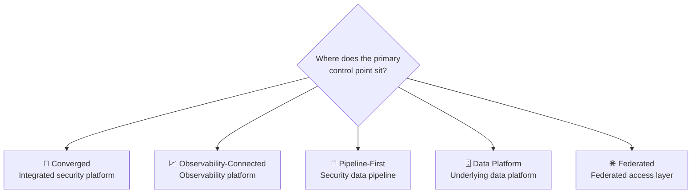
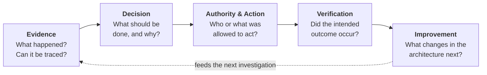
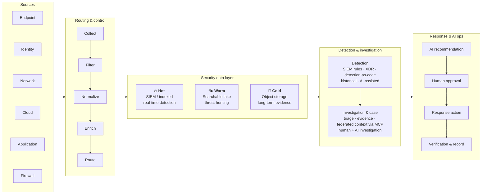

# MSAM: Modern SIEM Architecture Models

**A framework for classifying and evaluating SIEM architectures as security data spreads out and AI agents join the SOC.**

> 📖 **Full report:** [*The SIEM Problem Has Become an Architecture Problem*](https://softwareanalyst.substack.com/p/the-siem-problem-has-become-an-architecture), Software Analyst Cyber Research (SACR), October 2026.
>
> This repository is a structured, practitioner-friendly companion to that report: the framework, the five models, and a decision and proof-of-concept (POC) toolkit security teams can reuse.

---

## Why MSAM?

The traditional SIEM ran on one idea: **centralize everything**. Collect telemetry, index it, run detections, and investigate in the same system. That model is under strain:

| Pressure | What happens |
|---|---|
| **Cost shapes visibility** | Teams filter, sample, or drop telemetry to control ingestion and retention costs, which creates blind spots before an investigation even starts. |
| **Search speed is now part of incident response** | Slow or expensive historical searches delay triage and limit how far analysts can follow an attack. |
| **Detection engineering is a system** | Rules must be written, tested, tuned, deployed, and measured continuously. |
| **AI is a new class of analyst** | Agents need governed data access, visible reasoning, and controlled authority to act. |

So the question is no longer *"Which SIEM should we buy?"* It is **"Where should control over our security data sit?"**

> **Thesis:** The strongest SIEM architectures will give analysts and AI fast, trustworthy access to the evidence they need, while keeping control over cost, data ownership, response authority, and portability.

---

## The Framework at a Glance

MSAM classifies architectures by **where the primary control point sits**:

| Model | Control point | Best fit | Main risk | Examples |
|---|---|---|---|---|
| [**Converged**](models/01-converged.md) | Integrated security platform (SIEM + XDR + cases + AI + response) | Teams that want fewer tools and a single operating environment | Platform dependence and lock-in | Microsoft Sentinel, CrowdStrike Falcon Next-Gen SIEM, Palo Alto Cortex XSIAM, SentinelOne, Exaforce, Anomali, Daylight |
| [**Observability-Connected**](models/02-observability-connected.md) | Observability platform shared with engineering | Cloud-native orgs already standardized on one telemetry platform | Dependence on the observability platform's pricing, retention, and availability | Datadog Cloud SIEM |
| [**Pipeline-First**](models/03-pipeline-first.md) | Security data pipeline (filter, enrich, normalize, route) | Teams fighting ingestion costs or feeding many destinations | A bad filter creates blind spots across every downstream tool | Cribl, Brava |
| [**Data Platform**](models/04-data-platform.md) | Customer-controlled object storage or enterprise lakehouse | Orgs retaining large volumes of history that want to own their data | Owning data does not mean the SOC can use it fast | Scanner, Mitiga, Databricks |
| [**Federated**](models/05-federated.md) | Federated access layer that searches data where it lives | Large enterprises that cannot centralize (cost, regulation, M&A) | One search box can hide missing sources | Vega, 7AI, Artemis |

> Models overlap. Many vendors span more than one, and some enterprises combine several on purpose; a pipeline can feed a data platform while a federated layer searches it alongside an existing SIEM. **Vendors are classified by their dominant architectural control point.** Inclusion is illustrative, not an endorsement or ranking.

---

## Two Decisions Underneath Every Model

Every MSAM model is a mix of two deeper architecture choices:

| Decision | Option A | Option B | The trade-off |
|---|---|---|---|
| **1. Data plane** | **Customer-controlled:** tools operate across data you own | **Platform-controlled:** one vendor manages the full lifecycle | Control and portability vs. engineering load |
| **2. Operating model** | **Composable:** each component integrated independently | **Converged:** functions share one operating environment | Flexibility vs. simplicity and platform dependence |

1. **Data plane: customer-controlled or platform-controlled?** Owning the data plane gives you control over retention, portability, and storage cost, but your team manages integrations, schemas, permissions, and detections. A platform-controlled data plane cuts engineering work but deepens dependence.
2. **Operating model: composable or converged?** Composable stacks let you swap components (pipelines, storage, detections, cases, response, AI), but need strong integration and governance. Converged platforms simplify daily operations, but tie more of the SOC to one vendor's economics and direction.

The right balance depends on **team size, engineering capacity, existing investments, regulatory requirements, and data-control needs**.

---

## The Trusted SOC Test

Whatever model you pick, the architecture must keep this loop intact:

A false positive, a rejected AI recommendation, or a failed response action should feed back into detection logic, data policy, case workflow, or automation scope. It shouldn't just get closed out.

---

## The New SOC Data Architecture

The SIEM no longer has to own every layer of the security data lifecycle:

| Tier | Purpose | Typical data |
|---|---|---|
| **Hot** | Real-time detection, active investigations, frequent searches | EDR alerts, auth/identity events, firewall/WAF, high-priority cloud security logs |
| **Warm** | Incident response and threat hunting | Older identity logs, DNS, network flow, cloud control-plane, application logs |
| **Cold** | Compliance, forensics, long-term investigations | Archived raw logs, historical cloud activity, audit records |

---

## Repository Contents

| Path | What's inside |
|---|---|
| [`models/`](models/) | One page per model: how it works, strengths, risks, example vendors, and what to validate |
| [`decision-guide.md`](decision-guide.md) | The four architecture decisions, metrics to track, failure tests, and a 30/60/90-day plan |
| [`poc-checklist.md`](poc-checklist.md) | A copy-and-use checklist for SIEM proofs of concept |
| [`CITATION.cff`](CITATION.cff) | Citation metadata. Use **"Cite this repository"** in the sidebar |

---

## Author

**Uche Obiora** is a Security Research Analyst at Software Analyst Cyber Research (SACR), researching SIEM modernization, AI-driven security operations, and identity security.

MSAM was first published by Software Analyst Cyber Research (SACR). Vendor examples come from that research and are illustrative, not rankings or procurement recommendations. Vendor-reported performance figures should be validated in your own environment.
