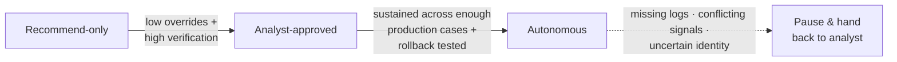

# 🧭 MSAM Decision Guide

> **A SIEM evaluation should end in an architecture decision, not a feature comparison.**

Each of the four decisions below comes with **metrics to track** and **failure tests to run** in a proof of concept. Metrics only mean something against a baseline, with thresholds set *before* testing starts.

---

## Step 0: Start with a baseline

- **Have an existing SIEM?** Spend **30 days** measuring today's environment against the metrics you plan to use in the POC. The baseline usually shows where investigations stall, which rules drive false positives, and what you pay to keep logs searchable. It often points to a targeted fix (such as moving long-term retention to object storage) before a full replacement is justified.
- **Building from scratch?** Set targets based on how far back investigations need to reach and how much engineering capacity you have.
- **Either way:** map where each critical log source is **routed, stored, and retained**, and **who can query it**.

---

## Decision 1: Where security data lives and how fast it can be queried

Cheap cold storage only helps if analysts and agents can query it within the time an active incident allows.

**📏 Track**
- Query latency at **90-day and 365-day** lookbacks
- Full cost of retrieval: scan charges, egress, and engineering effort
- **Log-gap rate:** how often an investigation needed data that was filtered out, aged out, or unreachable

> ⚠️ A *falling* retention bill with a *rising* log-gap rate means the pipeline or tiering policy is cutting too deep.

**🧪 Failure tests**
- [ ] Query 6–12 months of your own telemetry with analysts and agents searching at the same time
- [ ] Run the same investigation against indexed data and against federated or search-in-place sources
- [ ] Delay a pipeline or take a federated source offline. The platform should flag the gap, and an agent should lower its confidence or stop

---

## Decision 2: Where detections run and how they are maintained

Real-time identity and endpoint correlation usually belongs on indexed data. Long-window detections (low-and-slow credential abuse, beaconing) can run against cheaper storage if the latency is acceptable.

**📏 Track**
- **False-positive rate per rule**
- **Tuning cycle time:** from a reported false positive to a fixed rule in production

> A noisy rule fixed in a day is manageable. One that sits for weeks is a staffing and tooling problem, and a bigger rule library won't fix it.

**🧪 Failure tests**
- [ ] Replay existing detections against historical data in each candidate location
- [ ] Deploy, tune, and roll back a rule, including one written by an AI agent, under the same approval process as any other rule
- [ ] Rename a field in a key log source and see which rules silently stop firing

---

## Decision 3: What AI agents can access and do

Agent permissions should expand only when the case record earns it.

**📏 Track (per action type, e.g. disable account or isolate host)**
- **Override rate:** how often analysts reject or correct the agent
- **Verified-outcome rate:** how often an executed action was *independently confirmed* to work, not just assumed from a successful API call

> Low overrides with low verification means analysts agree with the agent while nobody checks whether the containment worked.

**🪜 Promotion criteria**

**🧪 Failure tests**
- [ ] Confirm read and write credentials are separate, and response permissions can be scoped by **asset, action type, and blast radius**
- [ ] Run containment actions and verify the end state **independently of the SOAR success status**
- [ ] Revoke an agent's permissions mid-investigation and force a partial containment failure. The system should stop, escalate, and leave enough context for an analyst to take over

---

## Decision 4: How much of the stack to own

It comes down to **exit cost vs. engineering load**. Converged platforms cut integration work and are harder to leave. Composable stacks are easier to change, but your team owns integrations, schemas, and detection logic.

**📏 Track**
- **Exit cost:** effort to export data, port detections, and keep access to historical logs after the contract ends
- **Engineering load:** effort to onboard a new source or ship a new detection *without* help from data engineering

**🧪 Failure tests**
- [ ] Export a meaningful dataset and query it outside the platform
- [ ] Port several custom detections to another engine and note what had to be rewritten
- [ ] Run the same investigation on native and third-party telemetry and compare results

---

## 🔁 Close the loop

Production results should send the team back to the decision that produced them:

| Signal in production | Revisit |
|---|---|
| Repeated false positives on one rule | Tuning, ownership, or execution location (**Decision 2**) |
| Investigations blocked by filtered or aged-out logs | Tier boundaries and pipeline rules (**Decision 1**) |
| Analysts repeatedly overriding one agent action type | The agent's context and permission level (**Decision 3**) |
| Response actions that fail verification or need rollback | Narrow permissions or add an approval step (**Decision 3**) |
| Rising effort to onboard sources or port detections | Control and portability (**Decision 4**) |

---

## 🗓️ 30 / 60 / 90-day plan

| Phase | Do this |
|---|---|
| **Days 1–30** | Baseline the current environment (or set targets), map the security data path, and set agent permission thresholds and POC pass/fail criteria |
| **Days 31–60** | Run the POC on your own data, including the failure tests above |
| **Days 61–90** | Compare results against the baseline, choose the architecture model, and decide what to add, move, or replace |

[← Back to MSAM overview](README.md) · [POC checklist →](poc-checklist.md)
