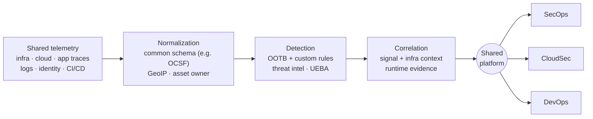

# 📈 Observability-Connected Model

**Control point:** the observability platform.

## How it works
Instead of building security analytics around a standalone SIEM, this model uses telemetry already collected across applications, cloud infrastructure, services, containers, logs, metrics, and traces.

## Why teams choose it
- Many security investigations are also operational investigations. A suspicious identity event may matter because it came right before a configuration change.
- It closes the gap between the security team that finds a problem and the engineering team that understands the affected service.
- AI-assisted investigations get operational evidence that a security-only dataset may not have.

## Main risk
Broader **dependence on the observability platform**: its pricing, retention model, and availability. There's also an ownership question: security and engineering share telemetry but not necessarily retention needs, permissions, or change control. Someone still has to decide who owns security parsers, who can change a detection, and who can view sensitive evidence.

## Example vendor
| Vendor | Why it fits | What to test |
|---|---|---|
| Datadog Cloud SIEM | Applies security detections to telemetry within its observability platform; Datadog Security, Case Management, Federated Logs, and Bits AI extend it into investigation and response | Federated vs. ingested investigation speed, whether Bits AI shows its evidence, and how autonomous actions are scoped and verified |

## SACR assessment
Observability-connected SIEM can improve investigations by giving security teams application, infrastructure, service, and deployment context alongside security evidence. Buyers should check whether **third-party security data** gets the same search performance and context as platform-native telemetry.

[← Back to MSAM overview](../README.md)
