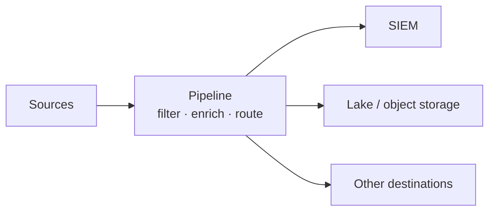

# 🔀 Pipeline-First Model

**Control point:** the security data pipeline.

## How it works
Control moves earlier in the data path. The pipeline decides how telemetry is **filtered, enriched, normalized, masked, reduced, or routed** before it reaches the systems that store and analyze it. Durable data lives downstream (SIEM, object storage, lakehouse, observability platform), and the pipeline controls which version of each event every destination receives.

## Why teams choose it
- Cut duplicate or low-value data before it reaches expensive analytics platforms.
- Enrich events with context once, upstream.
- Send the same telemetry to several destinations for different purposes.

## Main risk
**The pipeline becomes a critical point of failure.** One bad filter, transformation, or routing rule can remove important evidence before it reaches the SIEM, data lake, or AI system, creating blind spots across several tools at once. Detections and case management usually stay downstream, so upstream governance affects every investigation.

## Example vendors
| Vendor | Why it fits | What to test |
|---|---|---|
| Cribl Stream | Collects, processes, and routes events; transforms, enriches, reduces, and redacts data for one or more destinations | Change control and visibility into modified or dropped data |
| Brava Security | A security-focused version that uses attack simulations to find which logs and fields actually help detection, then filters the rest | Validate savings claims on your own telemetry and compare detection and investigation results before vs. after filtering |

## SACR assessment
Pipeline-first architectures can reduce unnecessary ingestion and improve data quality downstream. Teams need **strong change control, visibility into modified or dropped data, and a reliable way to recover from pipeline errors**.

[← Back to MSAM overview](../README.md)
