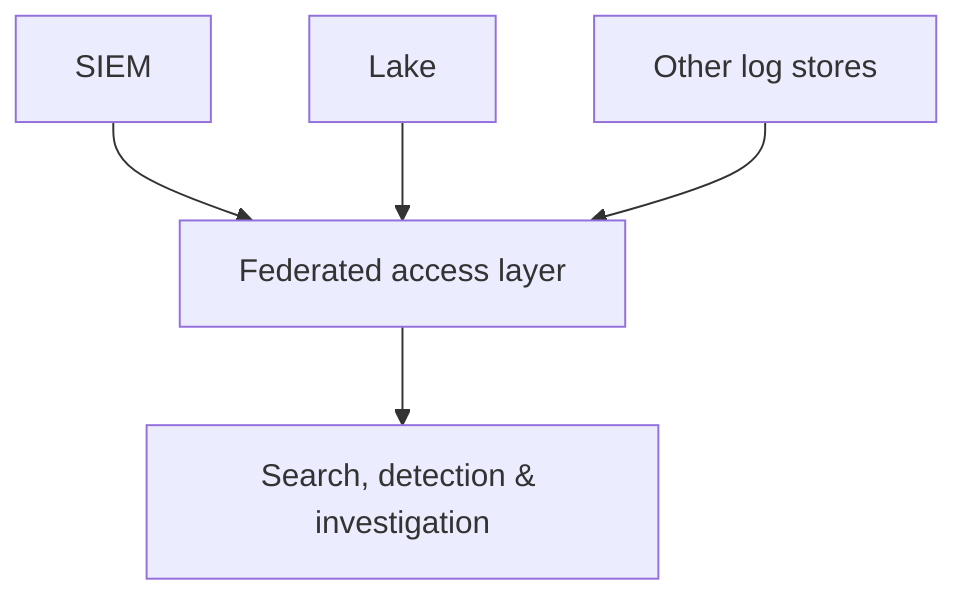

# 🌐 Federated Model

**Control point:** the federated access layer.

## How it works
Instead of moving everything into one central platform, the Federated model gives you one way to **search, analyze, and investigate data where it already lives**: existing SIEMs, data lakes, observability platforms, and other stores.

Protocols like the **Model Context Protocol (MCP)** may become part of this access layer, giving AI agents a common way to reach evidence in place instead of copying every dataset into the SIEM first.

## Why teams choose it
- Fits large enterprises that **can't easily centralize** because of cost, regulation, regional restrictions, acquisitions, or separate business-unit systems.
- Improves visibility across the existing environment without a long, disruptive data migration.

## Main risk
**A single search interface can make analysts think they see everything when sources are missing.** Federated sources differ in data format, query language, permission model, retention, and time handling, and they return results at different speeds. A search can *look* complete even when one source failed, timed out, or returned partial data.

A federated platform must show:
- which sources were searched, and which failed
- what data was transformed or normalized
- whether the investigation can be repeated later
- what "searching in place" really means (metadata copies, indexes, or caches)

## Example vendors
| Vendor | Why it fits | Notes |
|---|---|---|
| Vega | A federated analytics layer that searches across existing sources and combines that with detection, threat hunting, triage, and investigation | Also fits Data Platform as a secondary control point |
| 7AI | Federated SIEM that queries and correlates across existing sources, with agents for detection, investigation, hunting, and governed response | Some overlap with Converged; check what data stays in place vs. gets ingested or cached |
| Artemis Security | A hybrid version that ingests or queries data to build a living model of users, accounts, devices, cloud resources, AI agents, and their relationships | Overlaps Converged; uses federation to build environmental context |

## SACR assessment
Federated architectures help organizations use security data they can't or don't want to move. The platform should **clearly show gaps in access, coverage, and availability** instead of presenting partial results as a complete investigation.

[← Back to MSAM overview](../README.md)
